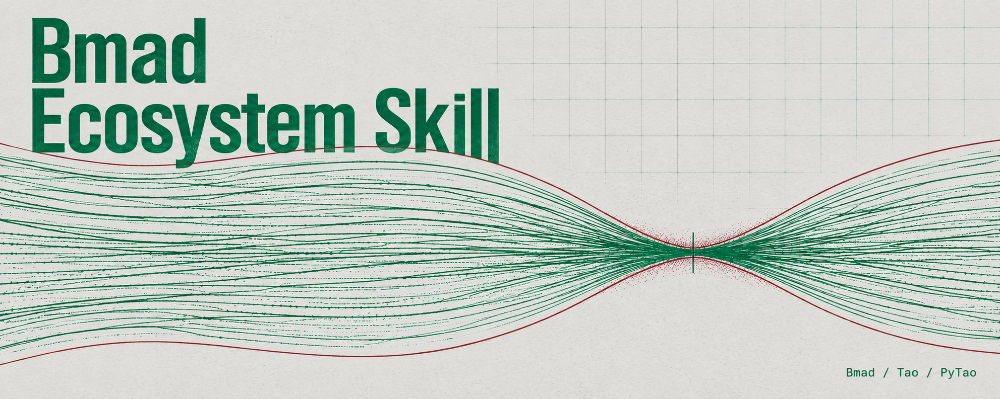

# Bmad Ecosystem Skill

An agent skill for accelerator modeling with
[Bmad](https://www.classe.cornell.edu/bmad),
[Tao](https://www.classe.cornell.edu/bmad/tao.html), and
[PyTao](https://bmad-sim.github.io/pytao/).

This repository packages domain knowledge, practical examples, and pointers to
official documentation so an AI coding agent can help with accelerator models.
It covers tool installation, lattice development, optics and particle tracking,
fitting, and Python analysis.

The skill follows the [Agent Skills format](https://agentskills.io/specification)
and includes a Claude Code plugin manifest. Its entry point is
[`skills/bmad-ecosystem/SKILL.md`](skills/bmad-ecosystem/SKILL.md).

## Install

Clone the repository and copy the complete `skills/bmad-ecosystem` directory
into your agent's skill search path. For a project that uses `.agents/skills`:

```sh
git clone https://github.com/ndwang/bmad-ecosystem-skill.git
mkdir -p /path/to/project/.agents/skills
cp -R bmad-ecosystem-skill/skills/bmad-ecosystem /path/to/project/.agents/skills/
```

For Claude Code, load the repository as a local plugin:

```sh
claude --plugin-dir /path/to/bmad-ecosystem-skill
```

Running calculations also requires the relevant Bmad/Tao/PyTao software.
See the [installation guide](skills/bmad-ecosystem/references/installation.md)
for runtime setup.

## License

Original repository content and the standalone skill are licensed under
[GPL-3.0-only](LICENSE).
